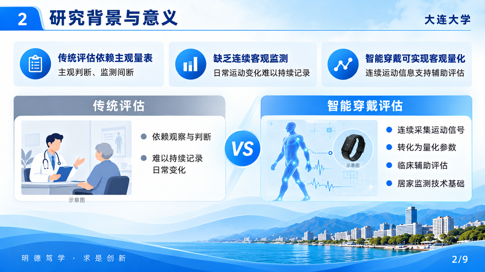
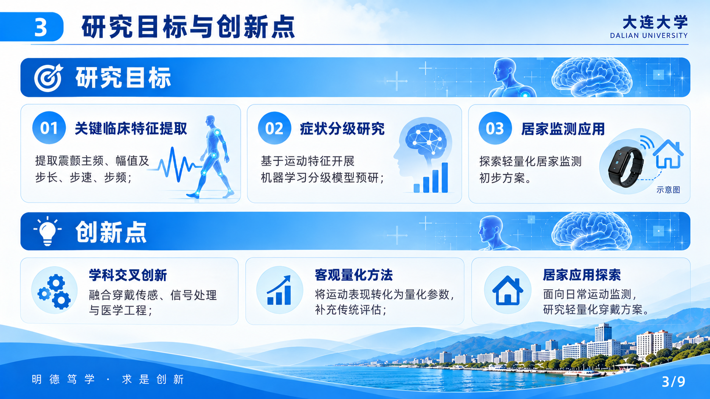
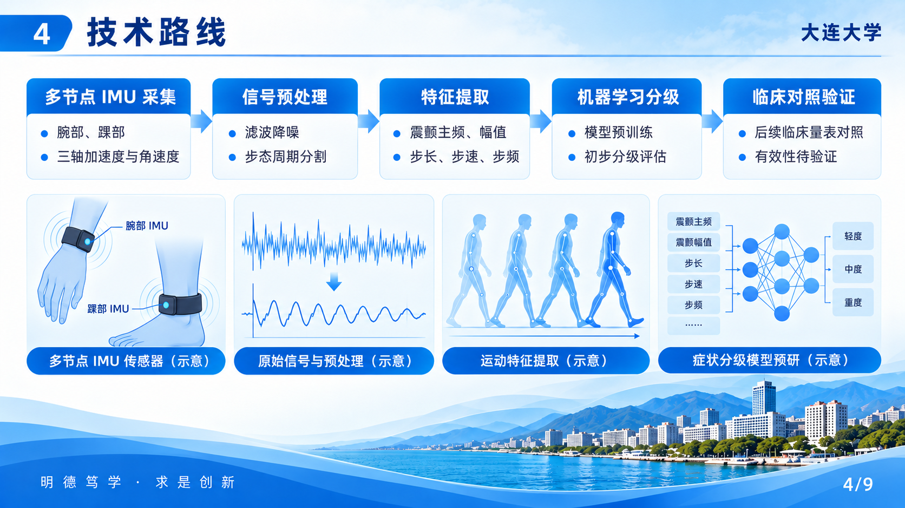
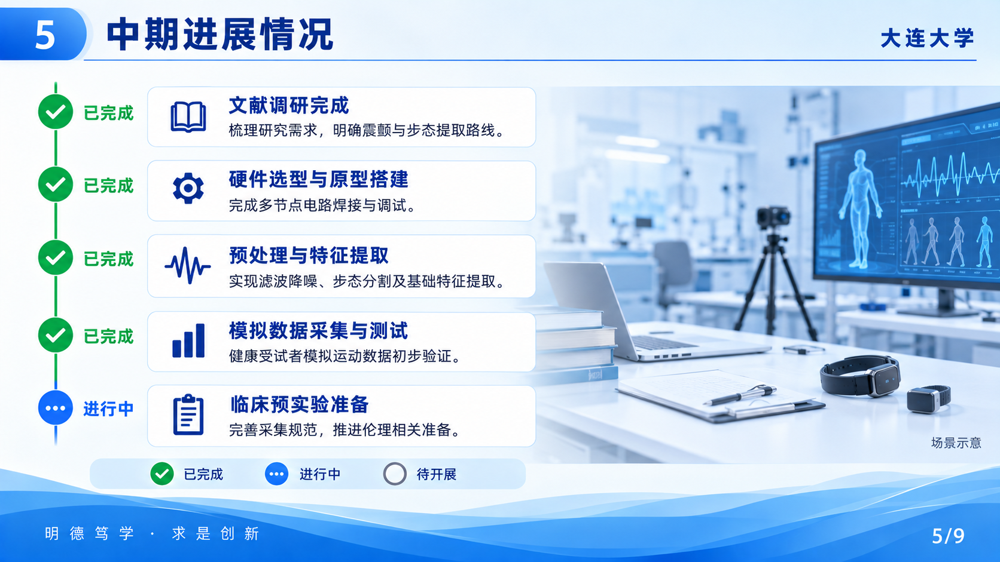
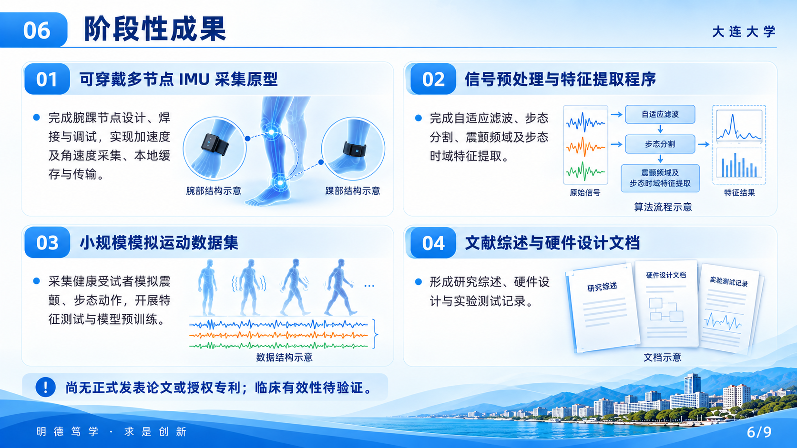
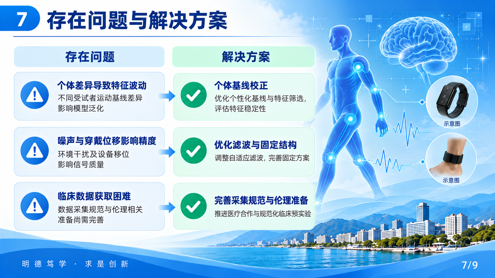
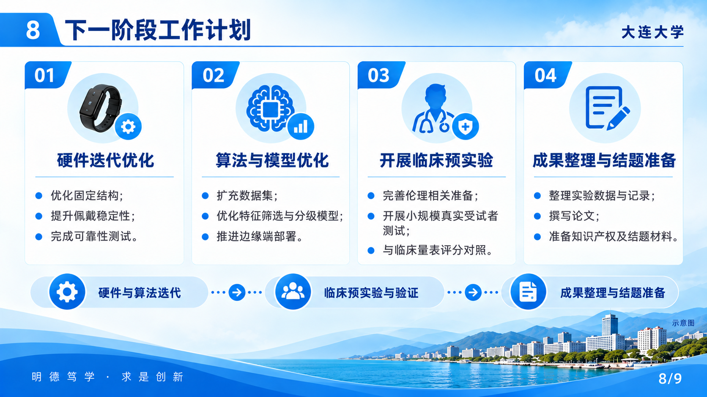
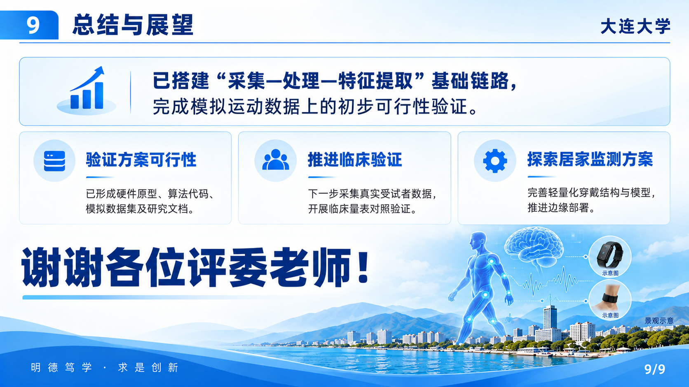

# 蓝白波浪风格单页视觉稿：第二版

参考用户选定拼图的页序与设计，采用已确认的 2026 年项目内容。共 9 张单页图片，非可编辑 PPTX。设备、波形、场景与景观为生成示意，不是实物照片或实验结果；正式制作时仍需核对文字细节。

## 第 1 页：封面

## 第 2 页：研究背景与意义

## 第 3 页：研究目标与创新点

## 第 4 页：技术路线

## 第 5 页：中期进展情况

## 第 6 页：阶段性成果

## 第 7 页：存在问题与解决方案

## 第 8 页：下一阶段工作计划

## 第 9 页：总结与展望

