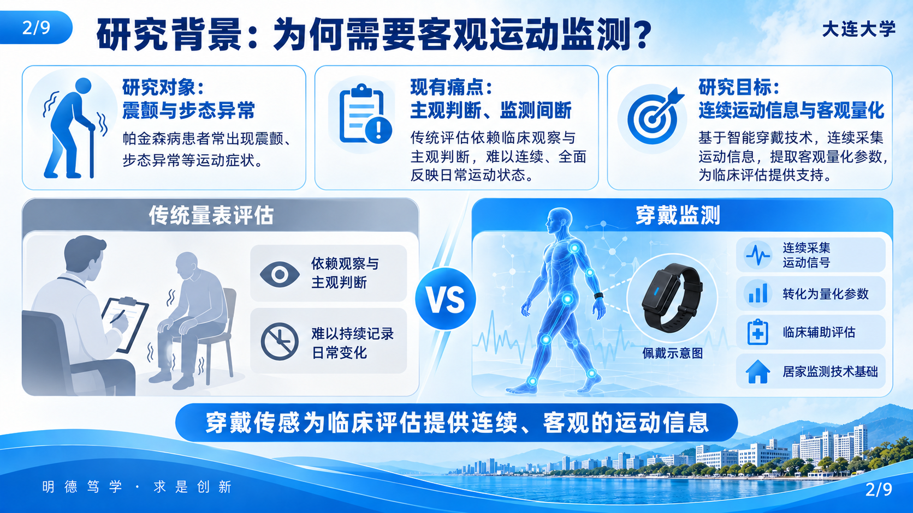
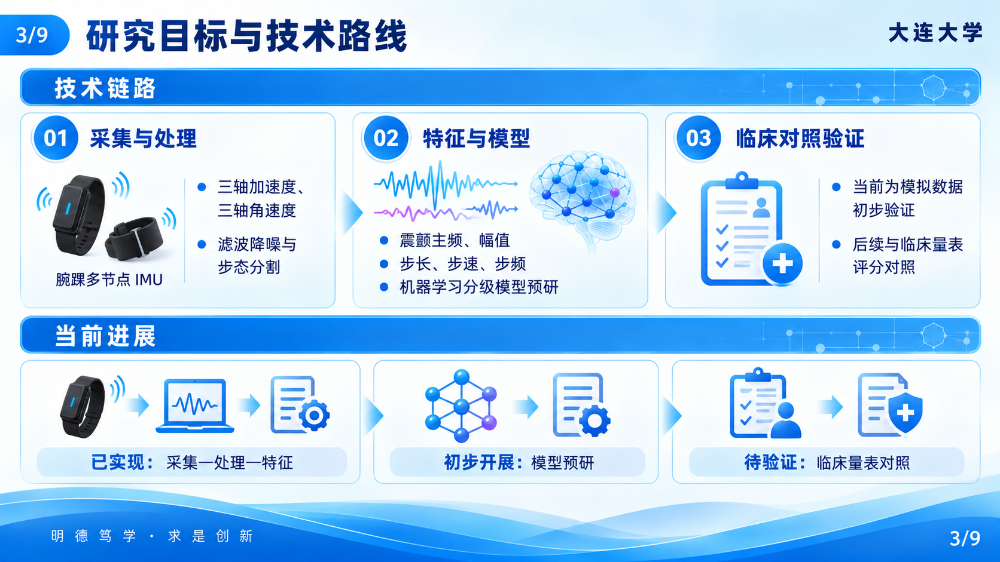
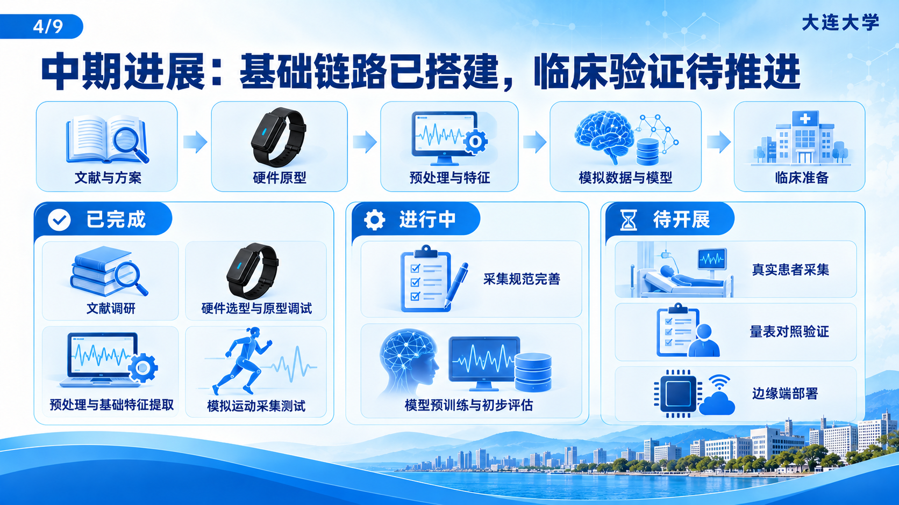
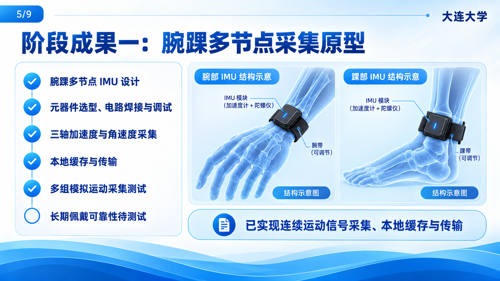
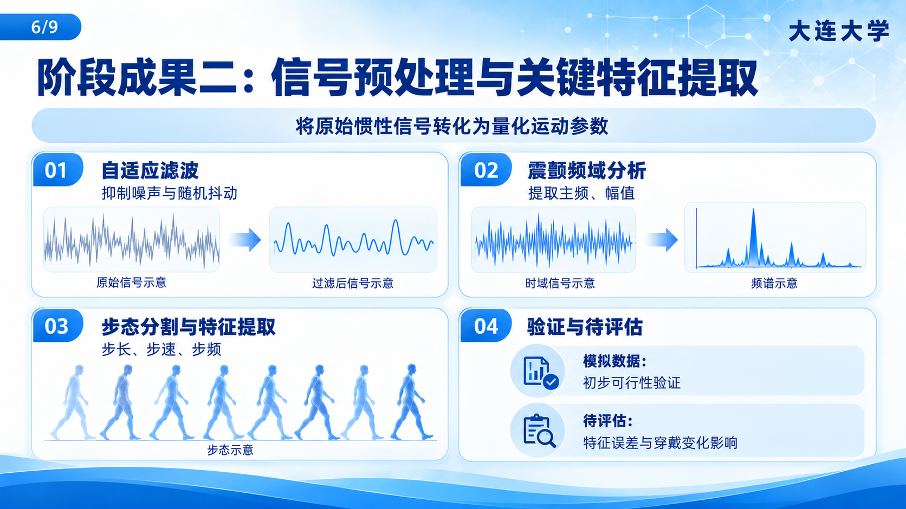
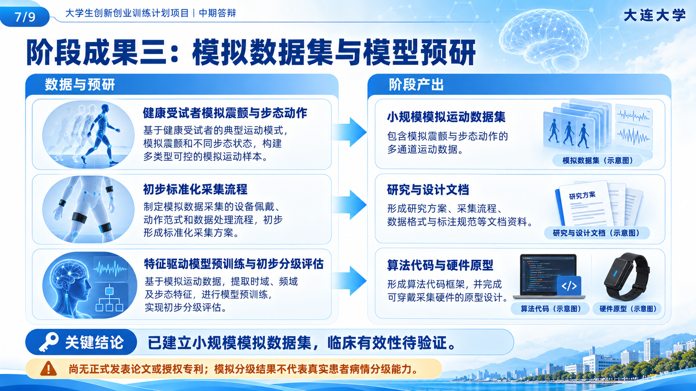
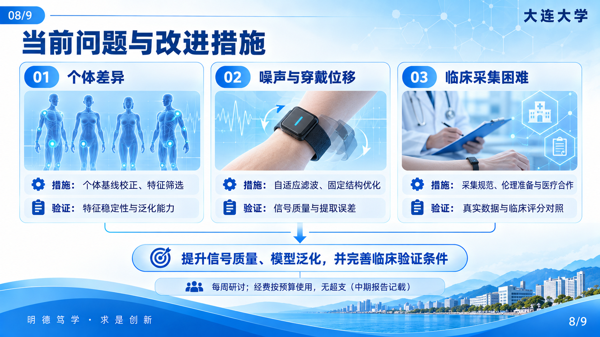
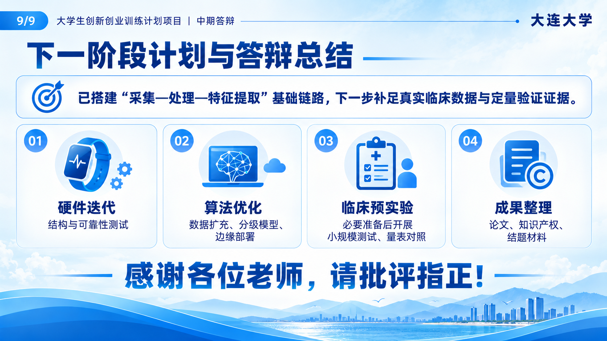

# 蓝白波浪风格：2026 年中期答辩单页视觉稿

按已确认的 2026 年内容生成，参考新拼图设计。生成图中的设备、波形、人物与景观均为视觉示意，并非实物、实验结果或学校实景照片。文字及页脚细节仍需在可编辑 PPT 制作时核对。

## 第 1 页

## 第 2 页

## 第 3 页

## 第 4 页

## 第 5 页

## 第 6 页

## 第 7 页

## 第 8 页

## 第 9 页

